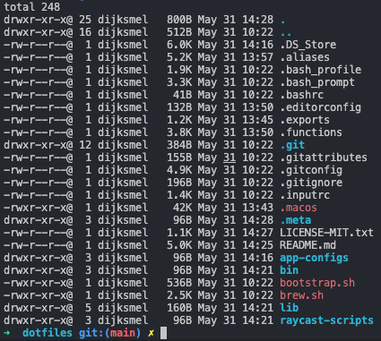

# Melle’s dotfiles



## Installation

**Warning:** If you want to give these dotfiles a try, you should first fork this repository, review the code, and remove things you don’t want or need. Don’t blindly use my settings unless you know what that entails. Use at your own risk!

## Requirements

- **macOS:** macOS (Xcode Command Line Tools & [Homebrew](https://brew.sh/) will be installed automatically if missing)
- **Linux (Ubuntu/Debian):** `apt` (built-in)

## Installation

### Quick Install (One-Liner on a Fresh Machine)

On a fresh macOS or Ubuntu/Debian installation, run:

```bash
bash -c "$(curl -fsSL https://raw.githubusercontent.com/melledijkstra/dotfiles/main/install.sh)"
```

This will ensure `git` (and Xcode Command Line Tools on macOS) is installed, clone the repository to `~/projects/dotfiles`, and launch the interactive installer.

### Using Git and the install script

Alternatively, you can clone the repository manually (recommended: `~/projects/dotfiles`). The interactive `install.sh` script asks upfront which steps you want to run, ensures core prerequisites (`git`, `curl`, `zsh`, `stow`, `Oh My Zsh`) are installed, and executes your selected steps.

```bash
git clone https://github.com/melledijkstra/dotfiles.git ~/projects/dotfiles
cd ~/projects/dotfiles
./install.sh
```

You can also run individual steps manually:

```bash
# Core prerequisites (git, curl, zsh, stow, Oh My Zsh, zsh-autosuggestions):
./core.sh

# On Ubuntu / Debian:
./apt.sh
# optional: installs GUI apps, e.g. Google Chrome, VS Code, Spotify and various dev tools
./apps-linux.sh
# optional: applies sensible Ubuntu (GNOME) desktop defaults
./ubuntu.sh

# On macOS:
./brew.sh
# optional: installs standalone macOS tools (e.g. Antigravity CLI)
./apps-macos.sh
# optional: applies sensible macOS defaults
./macos.sh

# Symlink dotfiles to $HOME (automatically backs up existing conflicts to ~/.dotfiles-backup):
./bootstrap.sh

# Cross-platform: Configure VS Code settings & install extensions:
./vscode.sh

# Clone or pull your development repositories from config/repos/*.txt:
./home/bin/sync-repos
```

## Updating the dotfiles

All scripts are idempotent and safe to run multiple times. To update at any time, just run `./install.sh` and it will pull the latest changes and update the components you select.

### Update only the dotfiles

To only update the home directory (~/) dot files (.zshrc, .path, .exports, etc.)
run the following command:

```bash
./bootstrap.sh
```

## Configurations

### Specify the `$PATH`

Here’s an example `~/.path` file that adds `/usr/local/bin` to the `$PATH`:

```bash
export PATH="/usr/local/bin:$PATH"
```

### Add secret configurations

#### Encrypted Secrets Workflow (`SOPS` + `age` + `direnv`)

Secrets are encrypted with [SOPS](https://github.com/getsops/sops) + [age](https://github.com/FiloSottile/age) and stored in a separate private directory/repository pointed to by `$SECRETS_DIR` (defaults to `~/projects/secrets`). Keeping encrypted files out of this public dotfiles repository ensures service/project filenames and environment variable key names stay private too.

**Directory layout (`$SECRETS_DIR`):**
```text
$SECRETS_DIR/
├── .sops.yaml            # Encryption rules targeting *.enc.{env,yaml,yml,json}
├── services/             # Shared/generic credentials (e.g. openai.enc.env, stripe.enc.env)
└── projects/             # Project-specific secrets (e.g. my-app.enc.env)
```

- **Key location (Linux & macOS):** `~/.config/sops/age/keys.txt` (`SOPS_AGE_KEY_FILE` is exported in `home/.exports` so macOS uses the same path as Linux).
- **Daily commands** (defined in `home/.functions` and `home/.config/direnv/direnvrc`):
  - `secrets-edit services/<name>` or `secrets-edit projects/<name>` — create or edit an encrypted file in `$EDITOR` (auto-encrypts on save; bare `<name>` defaults to `services/`).
  - `secrets-list` — list available encrypted files across `services/` and `projects/`.
  - `secrets-run <target> -- <cmd...>` — run a one-off command with secrets injected in memory via `sops exec-env`.
  - **Per-project auto-loading with `direnv`:** add a `.envrc` in any project directory and run `direnv allow`:
    ```bash
    use sops services/openai projects/my-app
    ```
    (Bare names like `use sops example` also auto-resolve across `services/` and `projects/`.) Secrets are decrypted in memory via `direnv_load sops exec-env` without writing plaintext `.env` files to disk.

#### Backing Up & Restoring Your `age` Key on a New Machine

Your private key at `~/.config/sops/age/keys.txt` is **never** committed to git. Store its contents securely in your password manager (e.g., 1Password, Bitwarden, or Apple Passwords).

On a new Linux or macOS machine:

1. Install packages and stow dotfiles as usual (`./install.sh`, or `./brew.sh` on macOS / `./apt.sh && ./apps-linux.sh` on Ubuntu + `./bootstrap.sh`).
2. Restore your private `age` key with strict permissions:
   ```bash
   mkdir -p ~/.config/sops/age && chmod 700 ~/.config/sops/age
   # Paste your saved key into ~/.config/sops/age/keys.txt
   chmod 600 ~/.config/sops/age/keys.txt
   ```
3. Clone your private secrets repository into `$SECRETS_DIR` and enable its pre-commit guard (or let `./install.sh` prompt for the URL and set it up for you):
   ```bash
   git clone <your-private-secrets-repo> "$SECRETS_DIR"
   git -C "$SECRETS_DIR" config core.hooksPath .githooks
   ```
4. Verify decryption works:
   ```bash
   secrets-list
   secrets-run services/example -- env | grep EXAMPLE_
   ```

#### Local Shell Overrides (`~/.secrets`)

For machine-local shell exports, functions, or alias overrides that you don’t want to commit, you can still use `~/.secrets` (see `home/.secrets.example`). You could also [fork this repository](https://github.com/melledijkstra/dotfiles/fork) for your own customization.

### Sensible macOS defaults

When setting up a new Mac, you may want to set some sensible macOS defaults:

```bash
./macos.sh
```

### Install Homebrew formulae

When setting up a new Mac, you may want to install some common [Homebrew](https://brew.sh/) formulae (after installing Homebrew, of course):

```bash
./brew.sh
```

Some of the functionality of these dotfiles depends on formulae installed by `brew.sh`. If you don’t plan to run `brew.sh`, you should look carefully through the script and manually install any particularly important ones.
